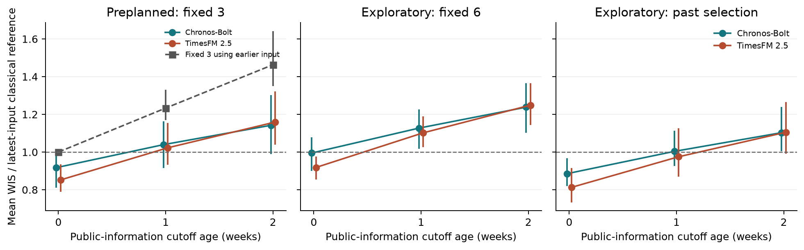
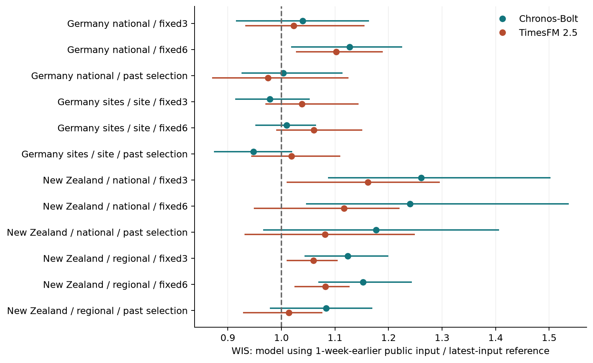


{{- value | replace('ドイツ全国・national','ドイツ全国') | replace('ドイツ地点・site','ドイツ地点') | replace('ニュージーランド・national','NZ全国') | replace('ニュージーランド・regional','NZ地域') | replace('NZ・national','NZ全国') | replace('NZ・regional','NZ地域') | replace('germany_national・national','ドイツ全国') | replace('germany_sites・site','ドイツ地点') | replace('nz・national','NZ全国') | replace('nz・regional','NZ地域') -}}

# 下水監視における予測器と公表情報の新しさ：実公表履歴に基づく比較

執筆：本研究セッションのAI。状態：{{ publication_status }}。実施条件と来歴は[manifest.json](manifest.json)、検証は[VERIFY.md](VERIFY.md)を参照。

## 要旨

下水サーベイランスでは、公表の遅れと過去値の改訂が感染動向の判断を左右する。本研究は公式Git日時を公表時点の代理とし、古い公表入力を使う汎用時系列予測と、最新入力を使う従来予測を比較した。事前計画のドイツ全国では、1週前入力の重み付き区間スコア（weighted interval score, WIS）の比はChronos-Bolt {{ main.c1.ratio_ci }}、TimesFM {{ main.t1.ratio_ci }}だった（最新3方法合成を1、小さいほど良い）。これは公表履歴の更新空白を含む平均で、同等性・非劣性を示さない。

最新入力と同一の比較がそれぞれ{{ main.c1.same_input_count }}/{{ main.c1.n_pairs }}、{{ main.t1.same_input_count }}/{{ main.t1.n_pairs }}あり、新しい観測週との差がある群では比は{{ '%.3f'|format(main.c1new.ratio) }}、{{ '%.3f'|format(main.t1new.ratio) }}だった。同じ方法の最新入力に対する1週前入力の比は、従来合成{{ '%.3f'|format(main.e1.ratio) }}、Chronos-Bolt {{ '%.3f'|format(review_facts['chronos_bolt_base|1|all|fresh_same_method'].ratio) }}、TimesFM {{ '%.3f'|format(review_facts['timesfm_2p5|1|all|fresh_same_method'].ratio) }}であり、予測器の差と情報更新の差を併せて判断する必要がある。病原体別の結果も一様ではなかった。2倍上昇は各対象位置{{ alerts_positive_count }}例に限られ、検出性能を結論できなかった。

査読後の探索的解析では、最新参照の予測距離が2週以下の組で、1週前入力のChronos-Boltの比は{{ review_facts['chronos_bolt_base|1|fresh_horizon_le2|fresh_ensemble'].ratio_ci }}だった。短い予測距離で運用する担当者は、休止期を含む平均だけを根拠に、最新入力を古い汎用予測へ置き換えるべきではない。測定・公表を早める因果効果、費用、臨床的な警報への効果は検証していない。

## 1. はじめに

下水サーベイランスは、検査を受けた個人に限らず、集団から排出された病原体の動向を継続して捉える手段である。実務で必要なのは、後日整った曲線を説明することに加え、今利用できる情報から、濃度が上がっているか、次の週にどう変わるかを判断することである。一方、採水から測定・集約・公表までには時間がかかる。濃度から感染動態を推定する場合にも、生物学的な時間差と検査室などの運用上の遅れは異なる。[Lison et al., 2026](https://doi.org/10.1038/s41467-026-75380-3)

この課題に取り組む監視担当者や予測研究者には、予測器を替えるべきか、より新しい測定・公表情報を使うべきかという設計上の判断がある。事前学習済みの時系列モデルは、対象ごとに重みを追加学習せずに予測を作れる。しかし、後日確定した系列を時点で切っただけの評価は、その時点で公表されていた値を使う評価と異なる。また、公表が週ごとでない場合、1週前の公開版と今の公開版が同じ観測終端を持つこともある。したがって、モデルの差を「何週分の情報を補える」と読み替える前に、実際に変わった入力と参照値を確認する必要がある。

研究質問は、**「1〜2週前の実公表情報を入力する事前学習済み汎用時系列予測は、最新情報を入力する従来予測と比べて、同じ週の下水濃度とその上昇をどこまで再現できるか。観測週の追加と既存値の改訂を区別すると比較はどう変わるか」**である。指標の精度を比較する研究であり、検査費用とモデル運用費用の交換比や、医療上の意思決定の効果を推定する研究ではない。

## 2. 先行研究と差分

下水情報を用いる予測も、報告遅延の扱いも、新しい着想ではない。[Radermacher et al., 2025](https://doi.org/10.1186/s12889-025-24149-2)はドイツの下水情報による短期入院予測を評価し、その設定では入院履歴だけの予測に下水情報を加える明確な利点を得なかった。同論文では利用時点までのデータが完全であることを仮定している。EpiSewerは下水から感染動態を推定し、将来の測定濃度も評価している。[Lison et al., 2026](https://doi.org/10.1038/s41467-026-75380-3) EpiFlowは下水から疾病指標を予測し、報告を遅らせるシミュレーションも含む。[Adiga et al., 2026, プレプリントv1](https://arxiv.org/html/2608.06671v1)

報告の追加と改訂を利用した現在推定には、報告遅延の三角表を扱うベイズ平滑化などの蓄積がある。[McGough et al., 2020](https://doi.org/10.1371/journal.pcbi.1007735) 改訂履歴を直接使って複数の監視指標を予測する研究もあり、対象は整数の件数だけではない。[Tang et al., 2025](https://doi.org/10.1371/journal.pcbi.1013709) CDCの公式実装も、下水と入院の実時点での予測と保存版による遡及的評価を行っている。下水入力の版を毎週保存したことも公式文書に記されており、実公表履歴を使うこと自体を本研究の新規性とはしない。[CDCgov公式実装・README](https://github.com/CDCgov/wastewater-informed-covid-forecasting) 対応する2026年プレプリントは検索で発見したが本文の直接取得が403だったため、結果の詳細の根拠には使わない。情報の新しさと質を分ける視点は、経済統計のリアルタイム予測にもある。[Giannone et al., 2005, 作業論文](https://www.federalreserve.gov/pubs/feds/2005/200542/200542pap.pdf)

本研究の差分は、新たな遅延補正モデルやスコアを発明することではない。調査した範囲では、事前学習済みの時系列予測と最新の従来予測を実際の下水公表履歴で直接比較し、**同一入力、既存履歴の更新、観測週の追加、後日の参照尺度**を併せて分けた評価は見つからなかった。これは先行例が存在しないという断定ではない。国・地点への拡張も同じ問いの適用範囲を調べるものである。

公表時点の版で評価する方法には長い蓄積がある。[Croushore and Stark, 2001](https://doi.org/10.1016/S0304-4076(01)00072-0)は経済統計のreal-time data setを構築し、AR予測と異なる参照値を比較した。[McDonald et al., 2021](https://doi.org/10.1073/pnas.2111453118)の補遺「Finalized Versus Vintage Data」は、COVID指標を確定版で評価すると実公表入力での評価とは方法ごとに異なる成績になることを示す。本研究はこの評価原則を新規な方法とはしない。

事前学習済み時系列モデルの感染症への適用も既存である。[EpiCastBench, Panja et al., 2026, v1](https://arxiv.org/html/2605.11598v1)は感染症の複数データでTimesFMやChronos-2を含む比較を行い、平均的な低誤差と、短い予測距離で従来の機械学習も競争的である結果を報告する。[Kalahasti et al., 2025](https://doi.org/10.1101/2025.02.24.25322795)も関連するが、本研究では著者頁の要旨のみ確認し、本文取得が403だったため、個別の性能の根拠には使わない。本研究の最新入力での比を、汎用モデルが感染症予測に使えることの初めての証拠とは位置づけない。

下水指標そのものの予測では、[Alhassan et al., 2025, v1](https://arxiv.org/html/2512.01074v1)が米国のNWSSで従来の複数モデルを比較し、予測距離・地域による違いを報告する。本研究の差分は、下水の将来濃度を予測することや距離依存の存在ではなく、実公表入力の新しさと汎用予測を組み合わせて最新従来予測との比較を行い、その平均を構成する更新条件を明示する点にある。

追加調査で確認した[Hu et al., 2026](https://doi.org/10.3389/fpubh.2026.1829302)も、報告頻度や改訂を明示的に表す予測器を提案し、症例・入院のデータでTimesFMなどと比較している。公表工程を重視する視点や汎用モデルと監視データの不一致も既存の論点である。本研究は、それら一般論の発見ではなく、下水の実公表入力で古い情報と最新情報の比較がどう変わるかを検証する。

提出前の再検索では、[VINTAGE-TS, 2026, プレプリントv1](https://arxiv.org/html/2609.28576v1)も確認した。同稿は公開時点と観測時点を分け、初回・成熟後の参照を定義した汎用時系列モデルの改訂対応を提案している。実行済みの数値評価は合成データの線形法などであり、実経済データとChronos-2の比較は未実行と明記する。本研究の差分は、この一般的な評価原則ではなく、実際の下水公表履歴で最新の従来法と古い汎用予測の損失を比較する点に限られる。

## 3. データと時点の定義

### 3.1 主要解析

ドイツAMELAGの公式公開Git履歴から、全国集計の変更版を固定した。{{ data_main }} データはRobert Koch-Institut・UmweltbundesamtのCC BY 4.0公開資料である。出典・取得日時・ハッシュ・文書は`sources.jsonl`、`data/downloads.jsonl`、各実験の索引に記録した。

対象はSARS-CoV-2、インフルエンザA、RSV A/Bの測定濃度である。SARS-CoV-2は公開された正規化済み指標を使い、他の2系列は非正規化の測定指標を使う。RSV A/Bと後のRSV A+Bを同じ定義としてつながない。平滑化曲線の列を将来予測とは扱わない。全国の週ラベルは木曜から水曜までの水曜終了週であり、異なる曜日の不適格な公開版は直前の適格版に戻った。これは予測前の入力監査で決め、除外版も保存した。

固定した最新版の公式説明は、週報では非正規化の`viruslast`を使い、正規化によるデータ品質の改善がなかったと記す。また、地点・検査室の系列平均を用いた全国集約の処理も説明している。これらの処理や改訂の存在自体は既知であり、本研究の発見ではない。主要解析で選んだ正規化指標への依存を調べるため、非正規化SARS-CoV-2の追加比較を計画した。[AMELAG固定版README](https://github.com/robert-koch-institut/Abwassersurveillance_AMELAG/blob/6586326ea292f4bfa243d8444d1efc8f4fef772d/Readme.md)

{{ review_calendar_text }}

{{ main_calendar }} 金曜の発行時点を基準に、その時点、1週前、2週前までに公表された最新版を入力する。対象は直前の水曜と次の水曜である。「1週前」は公表情報を利用できる締切を指し、最終測定日が必ず1週古いという意味ではない。

主要参照値は、対象週のラベル日から56日経過した日の終わりまでに得られた最新版の測定値とした。これは真のウイルス量でも最終的な確定値でもない。28日、84日、固定した最終公開版も感度解析で使う。56日の締切を通過していない値を、過去成績の学習に使わない。Gitのコミッター日時を公開時刻の代理として用いたため、独立に確認された実配信時刻と完全に一致する保証はない。

### 3.2 探索的な一般化

{{ panel_data_description }}

{{ review_nz_calendar_text }}

個人情報や患者データは収集しなかった。地点は公表済みの集計単位であり、少数の世帯・個人との照合は行わない。結果で個別の施設の優劣を示さない。地点・地域のハッシュラベルは表示上の識別子であり、匿名化の保証ではない。定義、標本密度、正規化、公表頻度が異なるため、国や組織の順位として読めない。

## 4. 方法

### 4.1 予測と比較条件

予測は濃度の常用対数で作る。履歴は最大104週、最小16個の実測値とし、系列内部の欠測を過去値で前方補完する。未来からの補間はしない。対象までの予測距離が16週を超える条件は範囲外として残す。入力済みの対象週を予測する条件は別に数える。

Chronos-Bolt baseとTimesFM 2.5の公開重みをローカルCPUで実行した。重みの追加学習、対象の地域名や病原体名などの入力は行っていない。モデルに渡すのは対数値の列であり、入力を識別する際は日付も含める。保存履歴は倍精度、汎用モデルへの数値入力はfloat32、従来法は倍精度である。{{ model_publication }} 公開前のTimesFM予測は較正用の計算と数値整合性の点検に使い、その時期の運用可能な成績とは解釈しない。既存の事前学習用データの全内容は確認できず、過去の下水データとの重複がないとは主張しない。

予測の9分位点は昇順に並べ直し、その後の中央分位点を点予測とした。この規則は予測前に固定した。数値列が同一でも、後の版で実測値が以前の補完値と一致する場合があるため、同一入力を同一の測定来歴とは呼ばない。補完割合の層別には公開版ごとの来歴を使う。

事前計画の従来参照は、非季節AutoARIMA、加法誤差のAutoETS、直近8点の傾きに減衰をかける予測の3方法から、分位点を等重みで平均した固定合成である。直前値継続も計算する。ARIMAの次数・差分・選択基準、ETSのモデル集合、分散推定は計画とコードに固定した。標準的なモデルの背景は[Hyndman and Athanasopoulos, Forecasting: Principles and Practice](https://otexts.com/fpp3/)を参照した。

主要結果を見た後、AutoTheta、前年同週を使う予測、調和回帰付きARIMAを追加した6方法の固定合成と、利用時点までに56日参照の締切を通過した直近26例から最良の従来法を選ぶ方法を追加した。最低12例が必要で、将来のテスト成績から選ぶ最良法ではない。これらは探索的比較である。全方法について、過去の利用可能な残差から分位点を補正する条件も計算する。補正による被覆率の保証は仮定しない。

地点・NZの追加比較には、国ごとに過去の複数系列を共有して学習する勾配ブースティングの分位点回帰も用いた。過去の水準、傾き、変動、予測距離、病原体区分、対象日の年周期を特徴量とし、地点IDや将来値を入れない。各発行時点より前に56日参照の締切を通過した例だけで学習し、ハイパーパラメータをテストで調整しない。この方法は、汎用モデルと情報量を揃えた比較ではない。設定・特徴量・学習行とモデルは保存した。[scikit-learn公式文書](https://scikit-learn.org/stable/modules/generated/sklearn.ensemble.HistGradientBoostingRegressor.html)

区間の補正方法への依存には、conformalized quantile regressionの非適合度に基づく移動窓補正も加えた。過去の中央区間からのはみ出しに基づいて端点を補正し、中央値は固定する。時系列の交換可能性を仮定できないため、同手法の被覆率保証を本研究に適用しない。詳細と全窓は付録に残す。[Romano et al., 2019](https://papers.nips.cc/paper/2019/hash/5103c3584b063c431bd1268e9b5e76fb-Abstract.html)

### 4.2 評価と不確かさ

主要指標は重み付き区間スコア（weighted interval score, WIS）、補助指標は中央値の平均絶対誤差（mean absolute error, MAE）、80%予測区間の被覆率である。WISは0.1から0.9までの9分位点のピンボール損失の平均を2倍した値で、中央区間による定義とも照合した。いずれも対数濃度上の値であり、小さいほど良い。スコアの定義は既存のものである。[Bracher et al., 2021](https://doi.org/10.1371/journal.pcbi.1008618)、[2022年訂正](https://doi.org/10.1371/journal.pcbi.1010592)

比は同じ対象を評価できる候補と参照の平均損失の比である。1未満は候補が小さい。主要区間は8週の移動ブロック再抽出による95%区間、4週・12週も保存する。各回で同じ発行週に含まれる系列と対象週を一緒に再抽出した。反復数は2,000、seedは12012である。系列数を独立した流行の数とは数えない。主要表の公称区間には多重比較調整を施しておらず、区間が1をまたぐことを同等性の証明としない。非劣性の許容幅も事前に設定していない。

上昇は同じ参照版の2週前に対する2倍以上の濃度と定義した。点予測の変化から通知を作り、過去の非上昇例の90百分位を閾値とする。意図した誤通知率は10%だが、テストでその率になる保証はない。予測分布の2時点間の依存を仮定して上昇確率を作ることはしない。元の方法の2倍上昇の受信者動作特性曲線（receiver operating characteristic curve, ROC曲線）は事前計画の補足、異なる上昇比率・追加方法のROC曲線と曲線下面積（area under the curve, AUC）は探索的解析として分ける。ROCはテスト全体から遡った識別性能であり、過去に利用できる閾値の成績とは異なる。上昇は公開下水指標の機械的な変化であり、臨床的な警報の正解ではない。

### 4.3 情報更新と尺度の点検

候補と参照について、保存された日付と対数値が同じ入力、同じ観測終端だが値などが変わった入力、新しい週まで測定が増えた入力を分ける。「同一入力」は保存履歴の定義で、公表物の全メタデータの同一性ではない。float32変換後の一致や、近い値を持つ履歴は別の探索的点検に分ける。

探索的な分解では、古い実公表入力A、最新公表版をAの観測終端まで切った入力B、最新入力Cを比較する。AからBへの差は既存週の改訂や採否、遅れて加わった観測を含み、BからCへの差は観測終端の延長を含む。これは順序を固定した記述的比較であり、公表工程を介入で変えた因果効果ではない。また、共通の過去の基準週からの変化を予測・参照の双方で測る解析を加えた。絶対水準の改訂と動向の予測を区別するためである。後日の最終版を過去の終端で切った条件も計算するが、未来の改訂を含む診断用であり、利用可能な予測器として比較しない。

査読後には、最新3方法の予測距離を2週以下/3週以上に分けた探索的解析を追加した。境界は査読者が結果を見て提案したものである。元と同じ評価カレンダーの8週ブロック・2000反復を使い、群外の週も0件として残した。予測距離の群を通常公表/休止の確定ラベルとは扱わず、公表の因果効果や多重比較調整済みの検定とはしない。

## 5. 結果

### 5.1 事前計画の主要結果

{{ main_availability }}

{{ table_primary }}

表1：最新の3方法固定合成に対するWIS比。従来合成自身の古い入力も参照行として併記した。括弧は8週ブロックによる95%区間。TimesFMは公開後の期間であり、Chronos-Boltと標本数が異なる。同じ行内では候補と参照を同じ対象で比較した。

{{ primary_interpretation }}

{{ table_information }}

表2：1週前の公表情報を使う場合の、入力の関係ごとのWIS比。これらの群はデータの更新過程に依存し、無作為に割り当てられた条件ではない。発行週の少ない群、特にTimesFMの同一入力群の区間は参考値とし、独立した流行例が十分あるとは解釈しない。

{{ table_review_pathogens }}

表3：事前計画の病原体別内訳。各方法・病原体・期間の同じ対象で、最新3方法に対する0・1・2週前入力を比較した。全テストのTimesFMも公開後だけを含む。区間は多重比較未調整であり、SARS-CoV-2での不利寄りの点推定を全病原体の平均で置き換えない。

{{ table_review_horizons }}

表4：査読後の探索的な予測距離別比較。各列は最新3方法を1とする。予測距離は最新参照の観測終端から対象週までの週数。群ごとの発行週は重複しうるため加算しない。

{{ review_horizon_interpretation }}

{{ table_review_own_age }}

表5：同じ方法で公表入力の新しさだけを比較した査読後の探索的集計。区間は多重比較未調整。同じ統計量でも、表1とは別の乱数系列で再抽出したため区間の端点が僅かに異なる。予測距離・暦時期を無作為に割り当てた比較ではない。TimesFMは公開後だけを対象とし、3行の評価期間は同じではない。行の比の大小を方法の順位と解釈しない。

{{ review_own_new_text }}

図：横軸は公表情報の締切の古さ（週）、縦軸は最新従来参照に対する平均WIS比。左は事前計画、灰色の四角は3方法合成自身、中央と右は探索的な参照。小さいほど低損失。モデル公開後の期間だけをそれぞれ評価している。

### 5.2 上昇の検出

{{ table_primary_alerts }}

{{ alerts_interpretation }}

{{ table_primary_auxiliary }}

表：主要の1週前入力と最新参照を同じ対象に揃えた点予測誤差と区間。区間幅は常用対数濃度上である。モデル公開後の期間を用いるため、モデル間の直接比較ではない。

### 5.3 探索的な強い比較・情報更新・参照尺度

{{ table_extended }}

{{ extended_interpretation }}

既存履歴の更新と新たな観測週の追加を順に分けた比較、基準週からの変化、参照版の感度は付録に示す。参照版は評価対象そのものを変えるため、最新版への一致を生物学的な正しさとは扱わない。

### 5.4 探索的な地点・別の公表制度への拡張

地点とNZへの探索的拡張では一様な関係を得なかった。国・単位ごとの全比較は付録に示す。NZはおおむね隔週公表であり、1週前入力でも最新入力と同一となる組が多いため、ドイツとの比の大小を直接比較しない。

### 5.5 探索的な共有学習・指標定義・時刻代理

共有学習はドイツ地点とNZで結果が異なった。指標定義と公表時刻代理の感度も含め、詳細は付録に残す。

### 5.6 探索的な入力履歴の古さへの頑健性

古い入力への相対的な頑健性と、最新入力の予測を置換できることは異なる。共同期間・複数比較の点検では頑健性の優位を確証できず、詳細を付録に示す。NZの暦上1週の差は隔週公表の影響を受ける。

### 5.7 探索的な入力履歴の長さ

履歴を最大256週へ伸ばした探索でも一様な改善はなかった。比の低下には最新従来の損失の増加による条件もあり、候補と参照の損失を別々に示す付録を参照されたい。

## 6. 考察

短い予測距離を主に使う監視担当者は、公表の更新空白を含む全体平均から、最新情報を1週前入力の汎用予測へ置換できると判断しない。予測器を替える検討では、対象病原体について、同じ情報での方法の差と、同じ方法での情報更新の差を並べる必要がある。より多くの従来法を組み合わせると比較も変わるため、単一の弱い参照への勝敗を導入の根拠にしない。この研究は、公表の迅速化やモデル導入の費用対効果、検査縮減、臨床的な警報の改善を判断する証拠までは与えない。

暦上の1週前入力が最新入力と同一になること自体は、公表日程から分かる性質である。発見と位置づけるべきなのはその存在ではなく、長い予測距離を含めた平均と短い予測距離の成績の差、病原体差、および強い参照で置換可能性の読み方が変わるという実測の比較である。条件による差はモデル、流行時期、更新過程が同時に変わった結果であり、観測を増やす政策の因果効果とは解釈しない。

{{ discussion_empirical }}

最新の従来予測を何にするかも比較の一部である。単純な直前値だけとの比較や、全テスト期間で良かった従来法を事後選択する比較では、実際の選択肢を十分表せない。本研究は固定合成と利用可能な過去成績による選択を両方残した。これでもあらゆる予測器や専門的な下水モデルを尽くしてはいない。モデル導入と公表の迅速化の費用を比較するには、別途運用上の費用と意思決定上の効用が必要である。

参照値の選び方は、測っている性質も変える。後日の濃度の水準に合うことと、現時点からの変化を捉えることは同一ではない。公開された正規化指標の将来改訂を当てる能力を、流行の上昇を捉える能力と読み替えないため、両方の評価を並べる必要がある。

## 7. 限界

第一に、これは公表履歴を遡る検証であり、当時実際に提出した予測ではない。Git日時は公開の代理で、履歴の完全性や配信時刻を独立に保証しない。選んだ適格性規則以外の処理を利用者が当時行えた可能性もある。数値の出所と版は保存したが、監査ログの不変性を証明したものではない。

第二に、主要参照は56日後の公開値で、病原体の真の量や真の感染者数ではない。正規化、採用地点、検査方法、標本数の変化が値に影響しうる。定量下限未満の標識も真値を与えない。内部欠測の前方補完は入力の一部を反復値にする。欠測や対象範囲外を除いた比較は、使える入力と参照があった条件に限定される。

第三に、検証期間に含まれる流行の数は限られる。複数地点や重なる2週の上昇は独立した事象ではなく、ブロック長を変えても未知の依存を全て扱えるわけではない。主要表と層別表の公称区間は多重比較未調整である。追加した共同期間の同時区間は国ごとの限定した比較群だけを対象とし、全結果を包括した調整や厳密な被覆保証とはしない。臨床的な警報の検証も伴わない。

第四に、事前学習済みモデルは固定した公開重みとローカル実装に限る。新しいモデル全般や将来の版に一般化しない。課題に合わせて汎用モデル自体を追加学習する比較は行っていない。共有学習の比較は特徴量と学習情報も変えるため、モデル構造の優劣を分離できない。TimesFMの公開前を含む較正用の過去予測は、当時利用できたモデルの履歴ではない。未補正の公開後の比較と分けて解釈する必要がある。

第五に、地点・NZ・追加従来法・情報分解は主要結果の後に計画した探索的検証である。テーマ選定では、指定されたモデルによる候補の批判を1回参照した。{{ critique_provenance }} 研究セッションの正確なモデル識別子は取得できず、批判モデルとの差異を実行系から直接照合できなかった。研究のコード、分析、解釈、論文はこのセッションで作成し、他モデルに代行させていない。入力指示の保存は不完全な転記であり、その欠落をmanifestと注記に明示した。

## 8. 再現性と研究過程

実験前の計画、変更理由、失敗した実行も保存した。計画確定と主要実行の順序はローカルGitと`events.jsonl`から追えるが、Git時刻は自己申告であり改ざん不能の証拠ではない。主張と証拠の対応は`claims.jsonl`、単一の入口による再計算と所要時間は[VERIFY.md](VERIFY.md)にある。保存予測からの再計算にAI API、重みのダウンロード、外部ネットワークは必要ない。{{ verification_status }}

査読は別のAIエージェントによる1回であり、人間から伝達された原文を`review/review-1.md`、指摘別の判断を`review/response-1.md`に保存した。査読者のモデル識別子や再実行の範囲は伝達された情報で、本研究者が直接観測したものではない。人間による査読や独立再現とは呼ばない。

## 参考文献

{{ references }}

## 付録

{{ appendices }}

### 公表日程と同一入力の分布（査読後）

{{ table_review_publication_gaps }}

{{ table_review_identity_weeks }}

同一入力の組数を発行週ごとに示す。「—」は同一入力の該当組がないことを示し、TimesFMの公開前は評価対象外である。モデル間で対象期間が異なる。

{{ table_review_horizon_distribution }}

{{ table_review_nz_intervals }}

NZの間隔はテスト期間内の公表日同士の差。適格性で後に除外する版も含む保存公表履歴の集計であり、検査室の作業頻度ではない。

### 地点・NZ・共有学習の全比較

{{ jp_units(panel_results) }}

{{ panel_figures }}

図：国・地点の順位ではなく、各データ内の同じ対象を比較したWIS比。予測対象、尺度、期間、入力・参照の欠測が異なり、図の上下を直接比較できない。NZは概ね隔週公表であり、暦上1週前入力でも同一入力の場合と複数週の観測差を持つ場合を含む。ドイツと同じ観測差を意味しない。この注意は上の比較表にも共通する。

{{ jp_units(pooled_results) }}

非正規化SARS指標との共通標本比較、公表時刻の代理をずらす感度は付録に示す。共有学習を含め、特定の参照だけを選んで主要解析の結論に置き換えない。

### 入力の古さへの頑健性と履歴長

{{ jp_units(interaction_results) }}

TimesFMについては、全国・固定3方法との比較でも、4週ブロックや2026年だけの条件では比の比の区間が1を含む。全ての期間・ブロック長で頑健とは結論しない。

{{ joint_main_note }}

{{ jp_units(history_results) }}

同じ点推定を主要表と再掲する条件でも、解析ごとに別の乱数系列でブロック再抽出をしたため区間の端点は僅かに異なる。元の保存値を変更して統一していない。主たる比較の区間は本文の主要表を参照する。

### 既存履歴の更新・観測追加・参照尺度

この付録の同一統計量の区間も、主要解析と独立の再抽出による端点の差を含む。点推定と対象の一致を確認し、区間差を結果の逆転とは読まない。

{{ update_results }}

{{ maturity_results }}

### 地点の測定条件と公表制度

{{ site_quality_results }}

{{ indicator_results }}

{{ timing_results }}

### 区間補正の感度

{{ calibration_results }}

### 入力の欠測・定数列・補完

{{ availability_results }}

### float32への変換・近い入力・補完条件

{{ jp_units(quality_results) }}

### 長い履歴の追加参照と数値互換性

{{ jp_units(history_appendix) }}

### 共同期間と複数比較への探索的感度

{{ joint_results }}

## 改訂履歴

初稿から、査読後の予測距離別解析と公表日程を追加し、同じ方法の情報の古さ、病原体別、少数週の内訳を前面に出した。主要数値・初稿の主張は保持し、全体平均の解釈を狭めた。探索表を付録へ移し、図注と書誌を訂正した。指摘別の根拠・変更・追加実験はreview/response-1.mdに示す。
